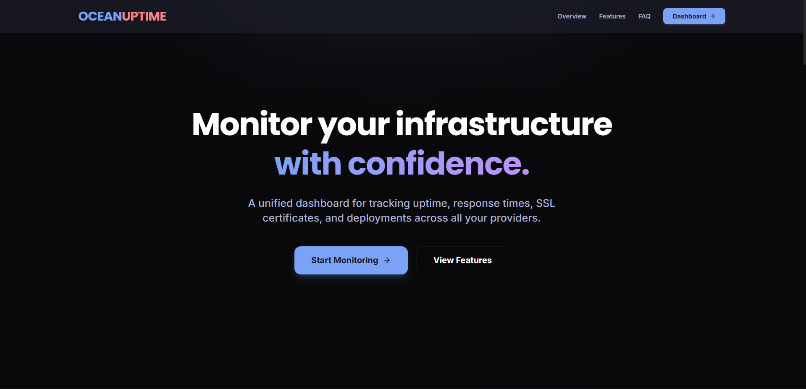
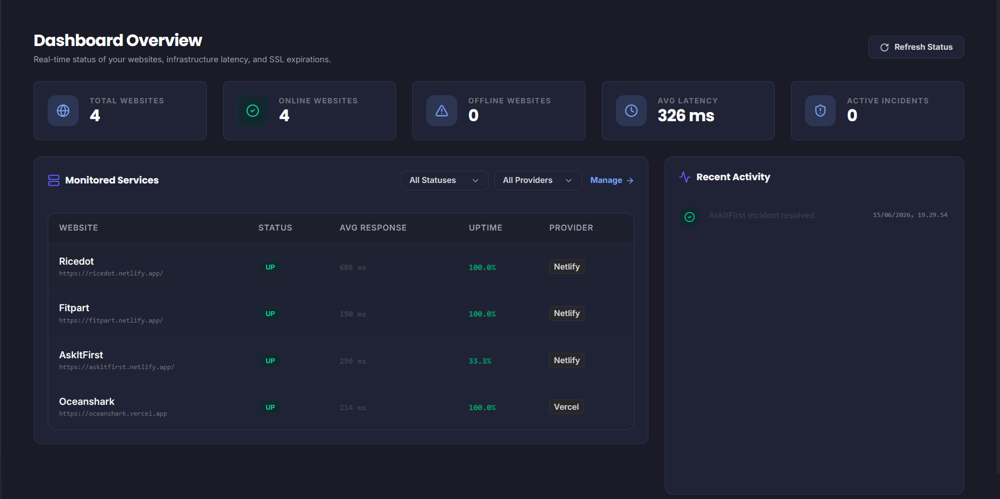
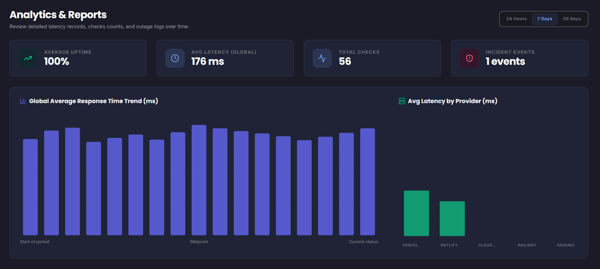

<div align="center">


# OceanUptime

OceanUptime adalah platform pemantauan uptime dan infrastruktur modern multi-penyedia hosting. Sistem ini dirancang untuk melacak ketersediaan situs web, performa latensi, validitas sertifikat SSL, status deployment, serta riwayat insiden secara terpusat dalam satu dasbor terpadu.



</div>

## Ikhtisar Arsitektur

Platform ini mengintegrasikan pemantauan ketersediaan waktu nyata dengan analitik performa infrastruktur web. Pemantauan berkala dilakukan untuk mengevaluasi kode status HTTP, waktu respon, sertifikat keamanan, serta integrasi deployment penyedia hosting terkemuka.

## Fitur Utama

| Modul | Deskripsi Kapabilitas |
| :--- | :--- |
| Pemantauan Uptime | Pengecekan HTTP dan HTTPS berkala dengan batas waktu sepuluh detik serta pencatatan latensi |
| Manajemen Insiden | Deteksi otomatis waktu henti layanan beserta durasi downtime dan pelacakan riwayat pemulihan |
| Pemantauan SSL | Pelacakan masa berlaku sertifikat, identitas penerbit, dan peringatan dini sebelum kedaluwarsa |
| Integrasi Deployment | Pelacakan status rilis terkini pada penyedia hosting seperti Vercel, Netlify, dan Cloudflare |
| Dasbor Analitik | Visualisasi metrik kesehatan sistem, persentase uptime, serta distribusi rata-rata waktu respon |

<div align="center">




</div>

## Tumpukan Teknologi

| Lapisan | Teknologi |
| :--- | :--- |
| Framework Aplikasi | Next.js 16 App Router |
| Bahasa Pemrograman | TypeScript 5 |
| Pustaka Antarmuka | React 19, Tailwind CSS 4, Framer Motion, Lucide React |
| Autentikasi dan Basis Data | Supabase SSR dan Supabase JS |
| Manajemen State | Zustand |
| Pengelola Paket | pnpm |

## Prasyarat Lingkungan

Pastikan perangkat lokal telah terpasang dependensi runtime berikut:

* Node.js versi 20 ke atas
* pnpm versi 9 ke atas

## Konfigurasi Variabel Lingkungan

Salin berkas contoh konfigurasi ke berkas `.env.local`:

```bash
cp .env.example .env.local
```

Isi variabel konfigurasi Supabase pada berkas `.env.local`:

```env
NEXT_PUBLIC_SUPABASE_URL=https://your-project.supabase.co
NEXT_PUBLIC_SUPABASE_ANON_KEY=your-anon-key
SUPABASE_SERVICE_ROLE_KEY=your-service-role-key
```

## Panduan Instalasi dan Menjalankan

1. Lakukan instalasi seluruh paket dependensi:

```bash
pnpm install
```

2. Jalankan server pengembangan lokal:

```bash
pnpm dev
```

3. Buka peramban web pada alamat `http://localhost:3000`.

## Alur Kerja Skrip Proyek

| Perintah | Deskripsi Fungsi |
| :--- | :--- |
| `pnpm dev` | Menjalankan server lokal Next.js dalam mode pengembangan |
| `pnpm build` | Melakukan kompilasi berkas produksi aplikasi secara optimal |
| `pnpm start` | Menjalankan server aplikasi Next.js dalam mode produksi |
| `pnpm lint` | Memeriksa kepatuhan format kode menggunakan ESLint |

## Struktur Direktori

```
oceanuptime/
├── app/
│   ├── api/
│   ├── auth/
│   ├── dashboard/
│   │   ├── analytics/
│   │   ├── deployment/
│   │   ├── incidents/
│   │   ├── monitors/
│   │   ├── overview/
│   │   └── ssl/
│   ├── globals.css
│   ├── layout.tsx
│   └── page.tsx
├── component/
├── context/
├── hooks/
├── public/
│   ├── Logo.png
│   └── images/
├── store/
├── utils/
└── package.json
```

## Kebijakan Lisensi

Proyek OceanUptime dilisensikan di bawah ketentuan lisensi privat untuk pengembangan internal. Seluruh hak cipta dilindungi undang-undang.
